# Mathematical Foundations for Machine Learning

A Python-based project exploring the mathematical and statistical foundations of machine learning through practical implementations, experiments, and visualizations.

## Project Overview

This project covers statistical analysis, linear regression implemented from scratch, dimensionality reduction, parameter estimation, hypothesis testing, and model evaluation.

## Topics Covered

- Descriptive statistics and data visualization
- Linear regression from scratch using the pseudoinverse
- Gradient descent and optimization
- Residual analysis and regression metrics
- Principal Component Analysis (PCA) using Singular Value Decomposition (SVD)
- Maximum Likelihood Estimation (MLE)
- Statistical hypothesis testing and confidence intervals
- Model evaluation and comparison with scikit-learn
- Reusable Python functions for regression

## Visualizations

### 1. Descriptive Statistics
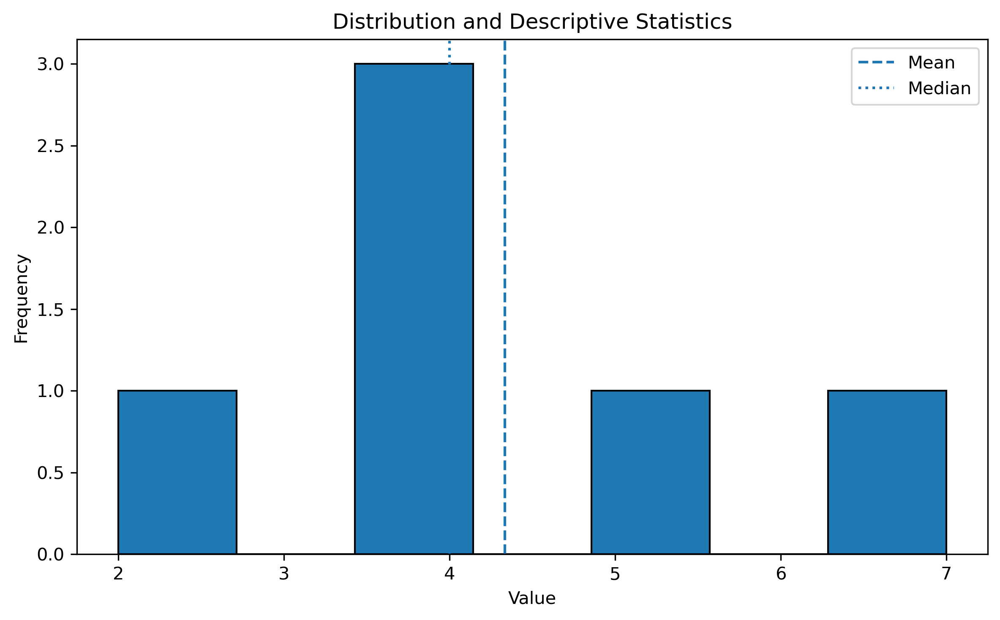

### 2. Linear Regression
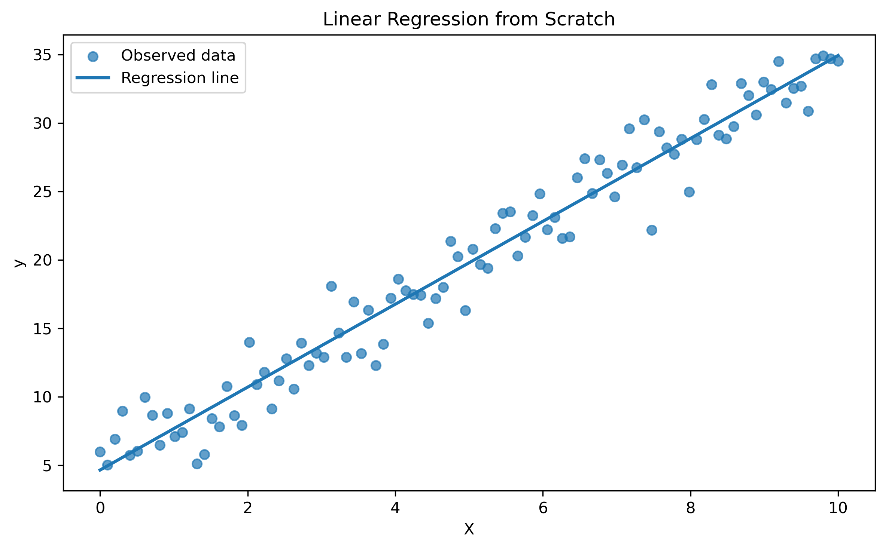

### 3. Gradient Descent
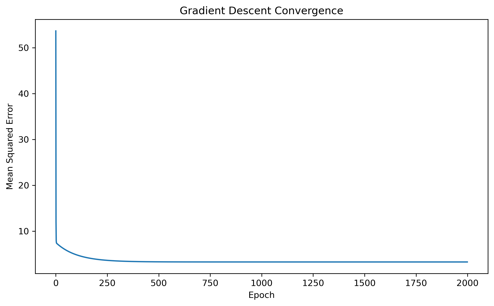

### 4. Residual Analysis
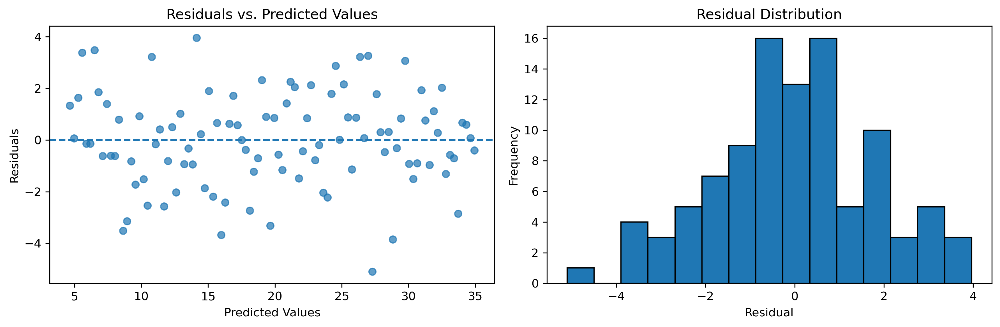

### 5. Test Set Predictions
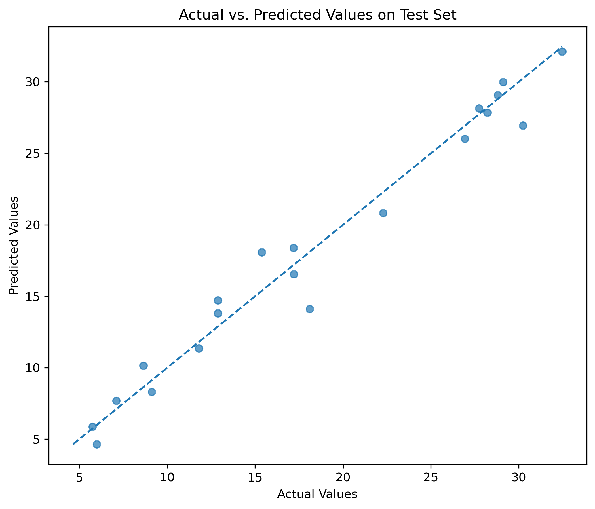

### 6. PCA Explained Variance
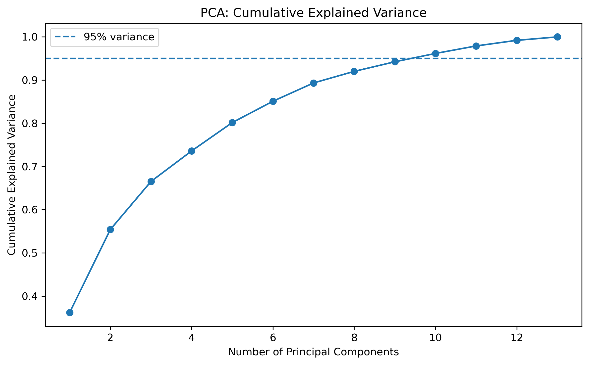

### 7. PCA Projection
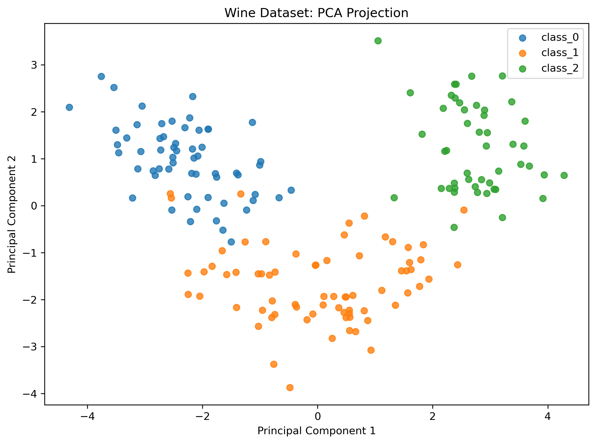

### 8. Maximum Likelihood Estimation
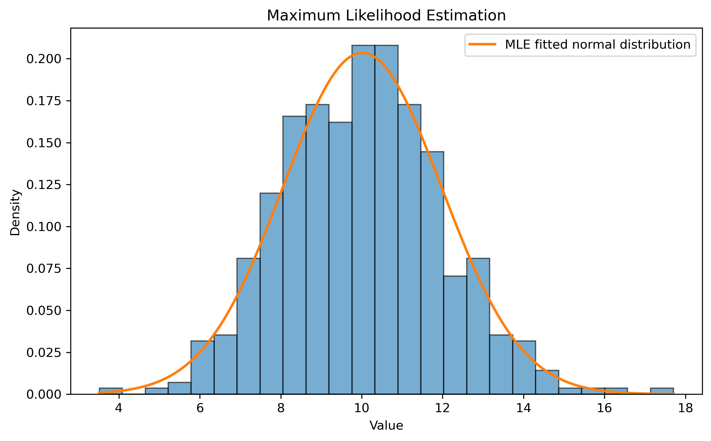

### 9. MLE Sample Size Analysis
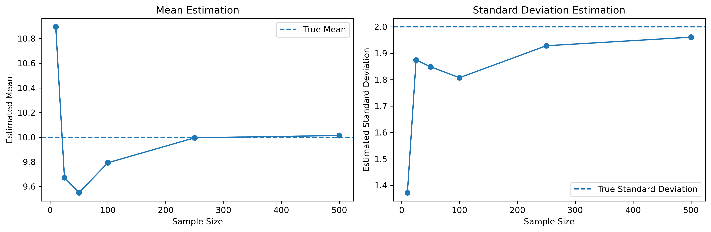

### 10. Hypothesis Testing
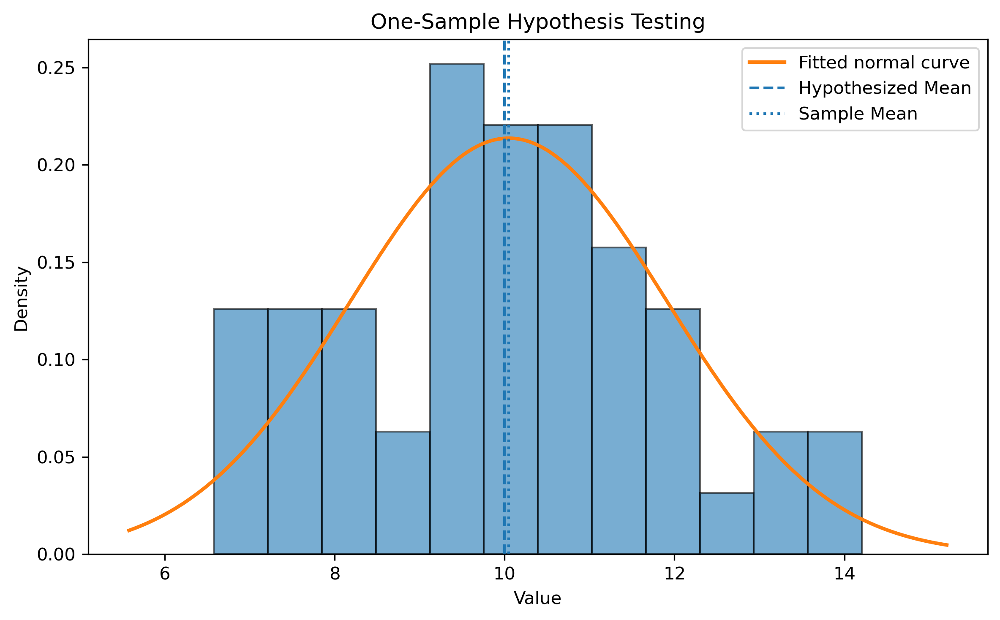

### 11. Model Evaluation
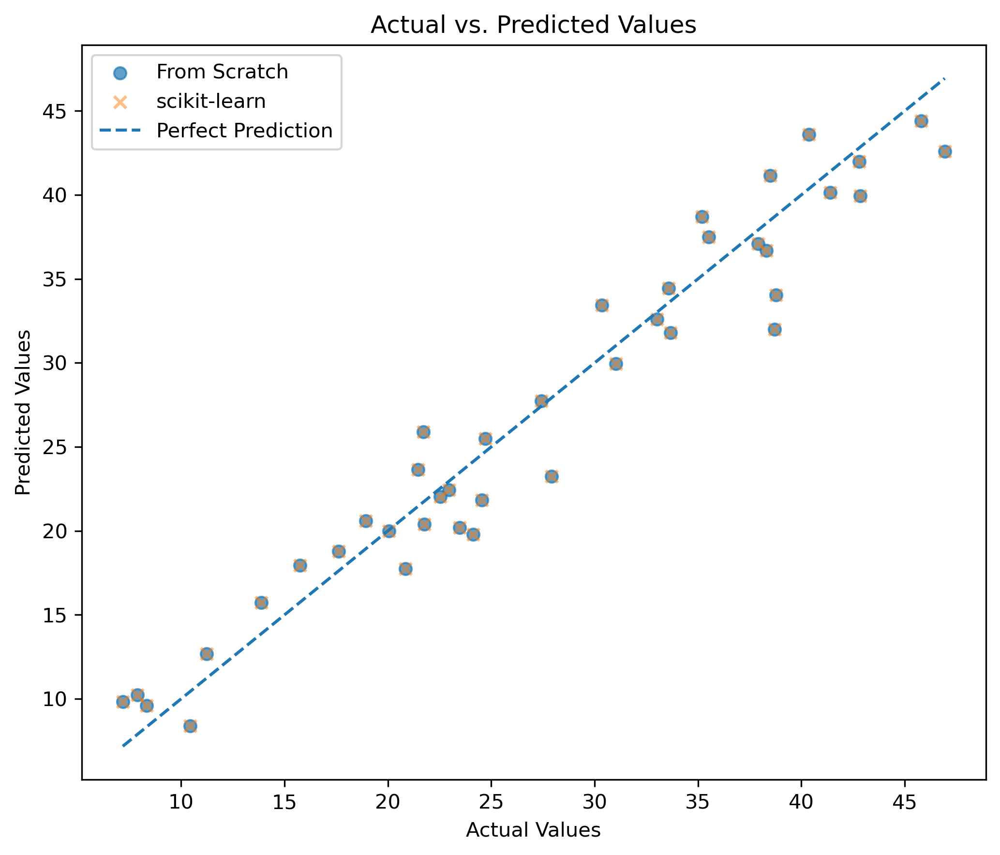

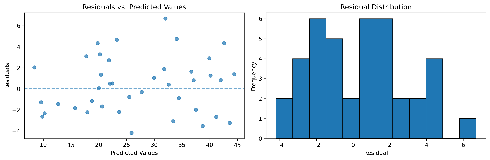

## Project Structure

```text
mathematical-foundations-ml/
├── notebooks/
│   ├── 01_statistical_analysis.ipynb
│   ├── 02_linear_regression_from_scratch.ipynb
│   ├── 03_pca_from_scratch.ipynb
│   ├── 04_maximum_likelihood_estimation.ipynb
│   ├── 05_hypothesis_testing.ipynb
│   └── 06_model_evaluation.ipynb
├── src/
│   └── regression.py
├── reports/
│   ├── figures/
│   ├── pca_results.csv
│   ├── pca_explained_variance.csv
│   ├── mle_sample_size_results.csv
│   ├── mle_summary.csv
│   ├── hypothesis_testing_results.csv
│   ├── model_evaluation.csv
│   └── model_predictions.csv
├── requirements.txt
└── README.md
```

## Technologies

- Python
- NumPy
- Pandas
- Matplotlib
- SciPy
- scikit-learn
- JupyterLab

## Installation

Clone the repository and install the required dependencies:

```bash
git clone <YOUR_REPOSITORY_URL>
cd mathematical-foundations-ml
pip install -r requirements.txt
```
